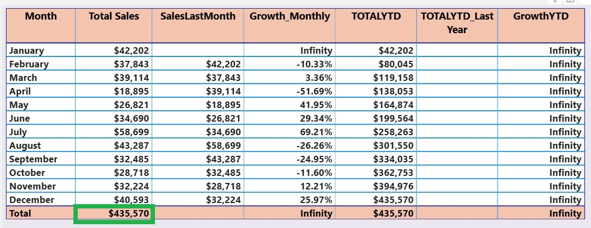
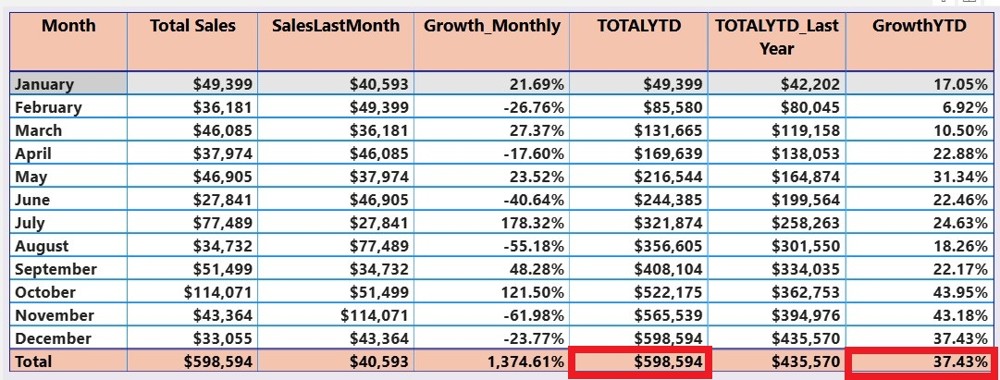
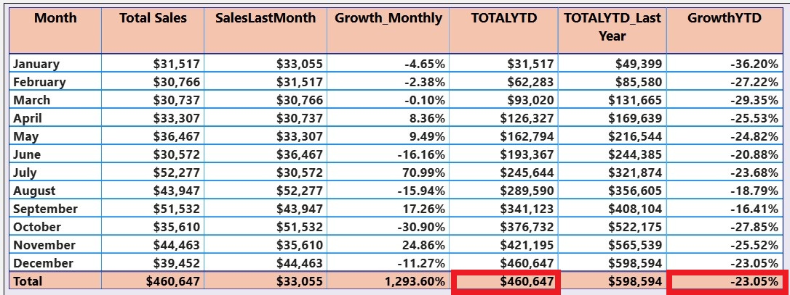
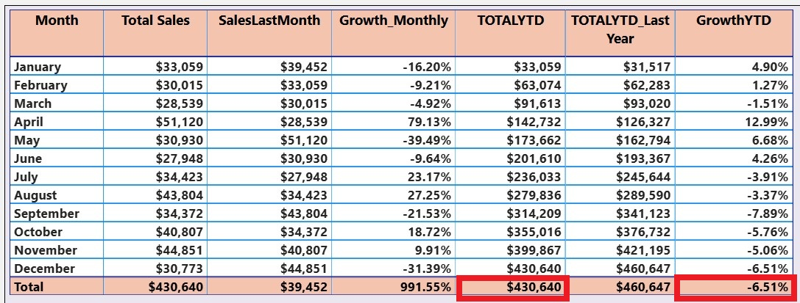
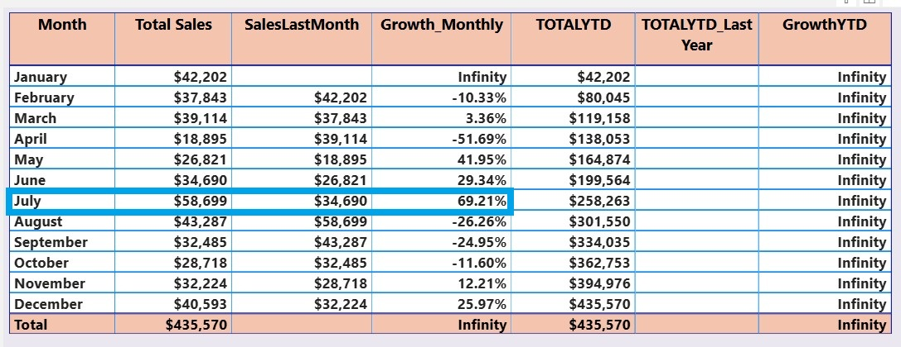
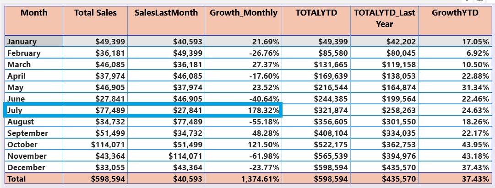
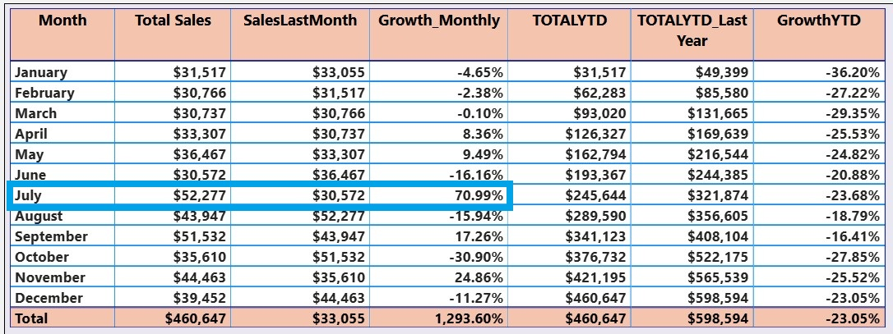
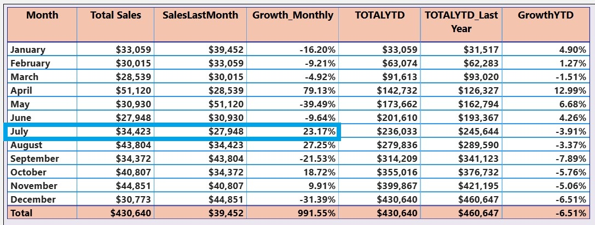

# Time Intelligence Analysis with DAX: Monthly & Year-to-Date Sales Growth (2015–2018)

A time intelligence analysis of four years of sales (2015–2018) using **DAX measures in Power BI**. The report tracks how sales change month-to-month and year-to-date, finds the best and worst years, and checks for seasonal patterns.

## Team & My Role

This was a **group project of 3 people**. My assigned task was the **Time Intelligence analysis**: building the DAX measures, analysing monthly and year-to-date sales growth, and writing up the findings and recommendations in this report.

## Project Overview

**Questions answered**
1. How did total sales change from year to year between 2015 and 2018?
2. How does each month compare with the previous month and with the same point last year?
3. Is there a recurring seasonal peak?

**Tools:** Power BI, DAX (time intelligence functions), a dedicated `Date` table.

## DAX Measures

| Measure | DAX | What it does |
|---|---|---|
| `TOTALYTD` | `TOTALYTD([Total Sales], 'Date'[Date])` | Running total of sales from January up to the current month |
| `TOTALYTD_LastYear` | `CALCULATE([TOTALYTD], SAMEPERIODLASTYEAR('Date'[Date]))` | Year-to-date sales for the same period last year |
| `SalesLastMonth` | `CALCULATE([Total Sales], PREVIOUSMONTH('Date'[Date]))` | Sales in the previous month |
| `Growth_Monthly` | `([Total Sales] - [SalesLastMonth]) / [SalesLastMonth]` | Month-over-month % change |
| `GrowthYTD` | `([TOTALYTD] - [TOTALYTD_LastYear]) / [TOTALYTD_LastYear]` | Year-to-date % change versus the same period last year |

`SalesLastMonth` and `Growth_Monthly` come from the Advanced DAX for Time Intelligence chapter of the course I followed (Chapter 15).

## Approach

1. Built a `Date` table and related it to the sales data.
2. Created the five measures above.
3. Displayed Total Sales, SalesLastMonth, Growth_Monthly, TOTALYTD, TOTALYTD_LastYear and GrowthYTD by month in a table, filtered to one year at a time.
4. Read the December row (full-year YTD) for annual performance, and the month rows for seasonality.

## Key Findings

### 1. Annual performance (2015–2018)

| Year | Total sales | Change vs previous year |
|---|---|---|
| 2015 | $435,570 | n/a (first year) |
| **2016** | **$598,594** | **+37.43%** |
| 2017 | $460,647 | −23.05% |
| 2018 | $430,640 | −6.51% |

- **2016 was the peak year**, up 37.43% on 2015.
- **Sales then fell for two years in a row.** 2017 dropped 23.05%, and 2018 fell a further 6.51%.
- **2018 ended slightly below 2015** (−$4,930, about −1.1%), and **28% below the 2016 peak**. The business has effectively lost all the growth it gained in 2016.
- The 2017 decline was visible all year: GrowthYTD was negative in every month, between −16% and −36%.

📊 *Year summary tables (December row = full-year total):*
### 2015

### 2016

### 2017

### 2018


### 2. July: a consistent rise over June

Sales rose sharply from June to July in **every** year:

| Year | June | July | July vs June |
|---|---|---|---|
| 2015 | $34,690 | $58,699 | +69.2% |
| 2016 | $27,841 | $77,489 | +178.3% |
| 2017 | $30,572 | $52,277 | +71.0% |
| 2018 | $27,948 | $34,423 | +23.2% |

- June is the **weakest month overall** across the four years ($121k in total), so July's jump partly reflects a low starting point.
- July is the **strongest month in 2015 and 2017**, and the strongest month when all four years are added together ($222,888, 11.6% of all sales).
- The pattern is **not guaranteed**: in 2016 the best month was October ($114,071), and in 2018 it was April ($51,120) with July only fifth.
- July's lead is narrow. October is a close second over four years ($219,206), and that is mainly because of the one-off October 2016 spike.
- The July-over-June jump has **shrunk each year since 2016** (+178% → +71% → +23%).

📊 *July highlighted in each year:*
### _2015 - highlight_

### _2016 - highlight_

### _2017 - highlight_

### _2018 - highlight_


### 3. Other observations
- **October 2016 was the single biggest month at $114,071** (+121.5% vs September). It contributed a large part of 2016's strong result and deserves its own investigation.
- Month-over-month growth swings a lot (for example −61.98% in November 2016 right after the October spike), so monthly percentages are volatile and best read alongside the YTD comparison.

## Recommendations
1. **Plan for the June-to-July uplift.** Time marketing campaigns and inventory build-up ahead of July, since it rises every year. Treat the size of the uplift as uncertain, because it has been getting smaller.
2. **Investigate the decline after 2016.** Find out why sales fell 23% in 2017 and what stopped them recovering in 2018 (for example product mix, customers, pricing or country-level changes).
3. **Investigate October 2016.** Check whether it came from a few very large orders or a real campaign, because that decides whether 2016 is a fair benchmark.

## Limitations & Things to Fix
- **Growth shows "Infinity" in 2015.** There is no earlier data, so dividing by blank gives Infinity. Use `DIVIDE()`, which returns blank instead:
  ```DAX
  Growth_Monthly = DIVIDE([Total Sales] - [SalesLastMonth], [SalesLastMonth])
  GrowthYTD = DIVIDE([TOTALYTD] - [TOTALYTD_LastYear], [TOTALYTD_LastYear])
  ```
- **The "Total" row of the table is misleading.** It shows values such as `SalesLastMonth = $40,593` and `Growth_Monthly = 1,374.61%` (2016), because it compares the full-year total against a single month. These should be hidden, or the measures should return blank when more than one month is in scope (e.g. `IF(HASONEVALUE('Date'[Month]), ...)`). Only the **TOTALYTD** and **GrowthYTD** totals are valid.
- **"July is always the strongest month" is too strong.** It holds for 2015 and 2017 only (see section 2).
- **No cause analysis yet.** The report shows when sales changed, but not why.
- **Outliers are unchecked.** A few very large orders could drive spikes such as July and October 2016.
- Measure references like `Sales[SalesLastMonth]` should be written as `[SalesLastMonth]` (measures aren't table columns).

## Possible Improvements
- Add **line / column charts** (monthly sales by year, YTD vs last-year YTD) so patterns are visible without reading tables.
- Add a **year slicer** and **month-by-year heatmap** to compare seasonality across all four years at once.
- Add further time intelligence measures: **rolling 3-month average** (`DATESINPERIOD`), **same month last year** (`SAMEPERIODLASTYEAR` / `DATEADD`), **QTD** and **MTD**.
- Break down sales by **product category and country** to find where the 2017–2018 decline came from.
- Test the effect of the largest orders by comparing growth with and without them.
- Build a short **forecast** using Power BI's analytics forecast or a simple seasonal model.

## Conclusion

Sales peaked in 2016 at $598,594 (+37.43%), then fell 23.05% in 2017 and 6.51% in 2018, finishing slightly below 2015. July reliably beats June, which makes it a good month to plan promotions around, though it is not always the top month. The next steps are to fix the Infinity and Total-row issues in the DAX, add charts, and find the drivers behind the 2016 spike and the decline that followed.
